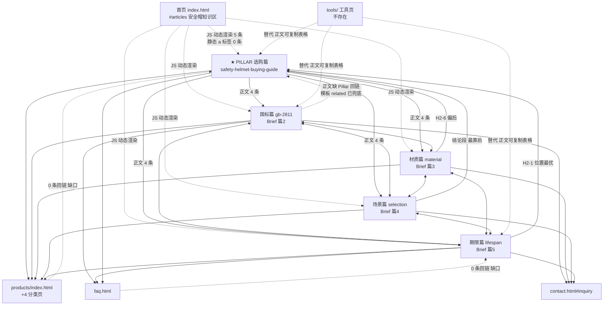

# 安全帽.cn · 链接策略与内容健康度联审报告（Phase 3）

- **站点**：安全帽.cn（punycode `xn--15qt0wm7b.cn`）｜GitHub Pages 静态站 `mfujun2025/anquanmao`
- **编制**：连乐桥（链接策略师 / 内容分析师）｜Phase 3 联审
- **日期**：2026-11-10
- **审计对象**：`articles/*.md` 5 篇交付稿 + `blog/*.html` 5 个发布页 + 全站静态页链接拓扑
- **依据**：`research/brief-anquanmao-2026-11-10.md`（尤其 §5 内容规格、§7 支撑素材库、§8 全站链接策略总表、§10 发布顺序）、`reports/delivery-report-anquanmao-2026-11-10.md`
- **纪律声明**：本报告**只做审计与建议**，未修改 `articles/`、`blog/`、`index.html`、`faq.html`、`products/`、`data/` 及任何脚本。所有建议目标页均在主理人核实的白名单内，未推荐 `tools/`、独立阻燃/防静电特性页等不存在的页面。

---

## 0. 审计口径与编号对照（先读，存在两套编号）

### 0.1 一个必须先澄清的歧义

主理人下发的消息里同时出现了两套「篇N」编号，若不澄清，「篇3 从 7 条精简到 5 条」会指向错误文件：

| 交付稿列表序号<br/>(= `build_articles.py` 的 `ORDER` = 发布顺序) | Brief §10 篇号 | 文件（主键） | 本报告简称 | 实测内链<br/>实例 / 去重目标 | 实测外链 |
|---|---|---|---|---|---|
| 1 | **篇1** | `safety-helmet-buying-guide.md` | **Pillar 选购篇** | 5 / 5 | 3 |
| 2 | **篇5** | `safety-helmet-lifespan-and-replacement.md` | 期限篇 | 7 / 5 | 3 |
| 3 | **篇2** | `gb-2811-2019-safety-helmet-standard.md` | 国标篇 | 6 / 5 | 5 |
| 4 | **篇3** | `safety-helmet-material-comparison.md` | **材质篇** | 7 / 6 | 1 |
| 5 | **篇4** | `safety-helmet-selection-by-industry.md` | 场景篇 | 7 / 5 | 0 |

**核验结论**：主理人预检的「篇1=5 条（4 篇 + 1 products）」「篇2=6 条」「篇3=7 条超上限」「篇5=5 条」与 **Brief §10 篇号** 一一对应（篇1 选购 5 条、篇2 国标 6 条、篇3 材质 7 条；篇5 期限的「5」正好等于其 **去重目标数**，属去重口径）。因此：

> **主理人点名要求精简的「篇3」= `safety-helmet-material-comparison.md`（材质篇，Brief 篇3，7 条内链实例）**，本报告 §3.1 给出完整的 7→5 删减方案。
>
> 同时，交付稿列表序号 3 的 `gb-2811-2019-safety-helmet-standard.md`（国标篇）实测 6 条实例，同样超出「3–5 条」规格，本报告 §3.2 一并给出精简表，**避免因编号歧义造成遗漏**。

**下文一律以文件 slug / 简称为主键**，不单独使用裸「篇N」。

### 0.2 内链计数口径

- **实例数**：交付稿正文中所有 Markdown 站内链接 `[锚文本](相对路径)` 的出现次数（含 CTA 段），不含 frontmatter、配图建议、外链。
- **去重目标数**：同一目标页在单篇内只计 1 次。
- **发布页实际口径**：`tools/build_articles.py::fix_links()` 会把 `blog/xxx.html` 转成同目录 `xxx.html`、`products/ faq contact about index` 补 `../` 前缀；此外 `TEMPLATE` 还自动生成导航、面包屑、**「延伸阅读 · 安全帽选型知识库」区（另外 4 篇同目录链接）**、`cta-box`、`toc-cta`、页脚。因此发布页 HTML 的实际链接密度显著高于 md 原稿，且**模板层已为每篇补齐了指向 Pillar 的链接**。

> 本报告 §1 的「是否缺 Pillar 回链」按 **md 原稿正文**判定（这是撰稿质量与可控项）；同时标注模板层兜底情况，避免把「已由模板补齐」误判为断链。

### 0.3 全站链接体检（脚本实测）

| 检查项 | 结果 |
|---|---|
| 全站相对链接唯一目标数 | **19**，缺失 **0** |
| `tools/` 类引用（含 `calc` / `checklist` 等工具页链接） | **0 处**（未产生死链） |
| 全站静态 HTML 中 `<a href>` 指向 `blog/` 文章的数量 | **0 条** ⚠️ |
| `sitemap.xml` 收录 5 篇 blog | ✅（priority 0.7） |
| 发布页 canonical / Article + BreadcrumbList JSON-LD | ✅ 5/5 |
| 首页 `#articles` 知识区 5 篇链接 | 由 `data/catalog.js` + `assets/js/shop.js::renderArticles()` **JS 动态渲染**，静态 HTML 中无 `<a href>` |

---

## 1. 文章概览与总体结论

| 简称 | 内链实例 | 去重目标 | 内链数量合规 | 锚文本过度精确匹配 | 正文 Pillar 回链 | products 转化链接 | 外链 | 外链合规(2–3) |
|---|---|---|---|---|---|---|---|---|
| Pillar 选购篇 | 5 | 5 | ✅ 合规（上限内） | 轻 | 自身即 Pillar | ✅ 1 条 | 3 | ✅ |
| 期限篇 | 7 | 5 | ⚠️ 超标 2（去重后合规） | 中（faq/products 重复） | ✅ 首 1/3，位置优 | ✅ 但重复 2 次 | 3 | ✅ |
| 国标篇 | 6 | 5 | ⚠️ 超标 1 | 中（contact 重复） | ❌ **正文缺失**（模板层已兜底） | ✅ 1 条 | 5 | ❌ 超标 |
| 材质篇（Brief 篇3） | 7 | 6 | ⚠️ **超标 2** | 中（products 重复） | ✅ 但在 H2-6，偏后 | ✅ 但重复 2 次 | 1 | ❌ 不足 |
| 场景篇 | 7 | 5 | ⚠️ **超标 2** | 中（products/contact 各重复） | ✅ 但在结论段，最靠后 | ✅ 但重复 2 次 | **0** | ❌ **严重不足** |

**总体结论**：

- **链接骨架是健康的**：0 死链、19 个目标全部可达、Pillar→4 Spoke 分发完整、Spoke 之间两两互链、每篇都有 products/ 转化出口、模板层「延伸阅读」区补齐了聚类闭环，`sitemap.xml` / JSON-LD 齐全。相比 Brief §3 竞品 Top10（几乎无内链体系），这是结构性领先。
- **但有 3 个系统性短板**：① 全站旧页面对文章的静态回链为 **0**，权重单向流出、聚类形成「孤岛→枢纽」而非双向网络；② 外链分布极不均衡（0 / 1 / 3 / 3 / 5），场景篇 0 外链、材质篇 1 外链，未达规格；③ 锚文本在全站层面存在明显雷同（Pillar 回链 3 篇一字不差）。
- **内容健康度评分：76 / 100（Needs Minor Fixes）**。评分明细见 §5.1。

---

## 2. 逐篇内链审计（现有清单：锚文本 → 目标）

> 目标路径均为 md 原稿写法；发布页实际路径由 `fix_links()` 转换后仍为白名单内页面，0 死链。

### 2.1 Pillar 选购篇 `safety-helmet-buying-guide.md`（5 条 · 最健康）

| # | 锚文本 | 目标 | 插入位置 |
|---|---|---|---|
| 1 | 安全帽国家标准 GB 2811-2019 全解读 | `blog/gb-2811-2019-safety-helmet-standard.html` | H2-1「先搞清楚」末 |
| 2 | ABS、HDPE 与玻璃钢材质对照 | `blog/safety-helmet-material-comparison.html` | H2-3 末 |
| 3 | 按行业场景挑选安全帽 | `blog/safety-helmet-selection-by-industry.html` | H2-4 末 |
| 4 | 安全帽使用期限与报废更换 | `blog/safety-helmet-lifespan-and-replacement.html` | H2-5 末 |
| 5 | 按场景挑选合规安全帽 | `products/index.html` | 结论 CTA |

- **数量**：5 条，恰在规格上限，✅ 全站唯一完全合规篇。
- **分布**：前 1/3 一条、中 1/3 两条、后 1/3 两条，✅ 全站最均匀；单段无堆叠。
- **锚文本**：4 条聚类分发用「该篇主关键词」做描述性锚文本，符合 Brief §8；「安全帽国家标准 GB 2811-2019 全解读」偏精确匹配但为长尾描述型，不构成堆砌。
- **Pillar 回链 / 转化**：自身即 Pillar（应收到回链，见 §2.2–2.5）；products 出口 ✅ 1 条，结论段同时以纯文本提及「业务咨询表单」而未加链接——**未重复计数，处理克制，值得保持**。
- **外链 3 条**：`ce.cn` 脆皮安全帽（导语）、`openstd.samr.gov.cn` GB 2811-2019 全文（H2-2）、`gov.cn` 25 号公告（H2-2）。✅ 已实测/核实，挂在具体论断后，是全站外链范式。
- **待办**：无必修；仅需配合 §6 的站点级回链与 noscript 兜底。

### 2.2 期限篇 `safety-helmet-lifespan-and-replacement.md`（7 条实例 / 5 目标）

| # | 锚文本 | 目标 | 位置 |
|---|---|---|---|
| 1 | ABS、HDPE 与玻璃钢材质对照 | `blog/safety-helmet-material-comparison.html` | H2-1 末 |
| 2 | 安全帽怎么选：五步采购决策指南 | `blog/safety-helmet-buying-guide.html` | H2-1 末 ★Pillar |
| 3 | 产品中心按类别挑选 | `products/index.html` | H2-4 末 |
| 4 | 常见问题页 | `faq.html` | H2-5 末 |
| 5 | 产品中心按类别挑选更换用安全帽 | `products/index.html` | 结论（与 #3 重复） |
| 6 | 提交业务咨询表单 | `contact.html#inquiry` | 结论 |
| 7 | 常见问题页 | `faq.html` | 结论（与 #4 重复） |

- **数量**：7 条实例 → 超标 2；**去重后 5 个目标**（material / buying-guide / products / faq / contact）——这正是主理人预检「篇5 内链 5 条」的口径，可确认预检采用去重口径。
- **Pillar 回链**：✅ 有，且位于 H2-1（首 1/3），**全站位置最优**，符合 Brief §8「正文首 1/3 内各 1 条」。
- **products**：✅ 有，但重复 2 次；**faq 重复 2 次**且锚文本一字不差「常见问题页」，描述性弱。
- **结构问题**：结论段堆叠 3 条链接（products + contact + faq），违反「单段落 ≤ 1–2 条链接」的质量准则，也是全站 7 条超标的共同成因。
- **外链 3 条 ✅**：`longling.gov.cn` 消费提示（H2-1 报废期限）、`openstd.samr.gov.cn`（H2-1 永久标识）、`labour.gov.hk` 香港劳工处指引（H2-3 每日/季度检查）。质量高、挂点精准。

### 2.3 国标篇 `gb-2811-2019-safety-helmet-standard.md`（6 条实例 / 5 目标）

| # | 锚文本 | 目标 | 位置 |
|---|---|---|---|
| 1 | 按行业场景挑选安全帽 | `blog/safety-helmet-selection-by-industry.html` | H2-3 末 |
| 2 | 安全帽使用期限与报废更换 | `blog/safety-helmet-lifespan-and-replacement.html` | H2-4 末 |
| 3 | 提交业务咨询表单 | `contact.html#inquiry` | H2-5 末 |
| 4 | 产品中心查看规格对照 | `products/index.html` | 结论 |
| 5 | 提交业务咨询表单 | `contact.html#inquiry` | 结论（与 #3 重复） |
| 6 | 常见问题页 | `faq.html` | 结论 |

- **数量**：6 条实例 → 超标 1；去重 5。
- **❌ 正文 Pillar 回链缺失**：6 条内链中**没有一条指向 `safety-helmet-buying-guide.html`**，这是全站唯一正文缺 Pillar 回链的 Spoke，直接违反 Brief §8「每篇必须含 1 条回链 Pillar」。
  - *兜底说明*：发布页模板「延伸阅读」区已自动链向另外 4 篇（含 Pillar），因此**线上不是断链**；但模板锚文本为固定的短标题（`安全帽怎么选：五步采购决策指南`），权重与相关性传递弱于正文上下文链接，且不计入撰稿规格。→ 判为 **P0 必修**。
- **外链 5 条 ❌ 超标**：`openstd`（H2-1）、`amr.hefei.gov.cn`（H2-2）、`bjppe.iuse.ac.cn`（H2-2）、`ce.cn`（H2-4）、`gov.cn` 25 号公告（H2-5）。超出 Brief §5「2–3 条」规格，且 `amr.hefei` 与 `bjppe` 同挂 H2-2 一句、功能重叠。
- **contact 重复 2 次**（H2-5 与结论）。

### 2.4 材质篇 `safety-helmet-material-comparison.md`（7 条实例 / 6 目标）★ 主理人点名「篇3」

| # | 锚文本 | 目标 | 位置 |
|---|---|---|---|
| 1 | 产品中心看规格对照 | `products/index.html` | H2-3 末 |
| 2 | GB 2811-2019 对材料与标记的要求 | `blog/gb-2811-2019-safety-helmet-standard.html` | H2-4 末 |
| 3 | 按行业场景挑选安全帽 | `blog/safety-helmet-selection-by-industry.html` | H2-6 末 |
| 4 | 安全帽怎么选：五步采购决策指南 | `blog/safety-helmet-buying-guide.html` | H2-6 末 ★Pillar |
| 5 | 轻便透气款的结构配置 | `products/lightweight.html` | FAQ 第 2 问 |
| 6 | 产品中心做规格对照 | `products/index.html` | 结论（与 #1 重复） |
| 7 | 提交业务咨询表单 | `contact.html#inquiry` | 结论 |

- **数量**：7 条实例 → **超标 2，需精简到 ≤5**（主理人指定项，方案见 §3.1）。
- **Pillar 回链**：✅ 有，但位于 H2-6（后 1/3），且锚文本与另外 2 篇完全相同 → 建议前移 + 改写（§3.3）。
- **products**：✅ 有，但重复 2 次；另有 `products/lightweight.html` 深链 —— **全站唯一指向具体分类页的内链**，转化与场景相关性高，属优质资产，**精简时必须保留**。
- **外链仅 1 条 ❌**：只有导语的 `ce.cn` 脆皮安全帽。正文 H2-4「GB 2811-2019 对佩戴高度、垂直间距、水平间距都有要求」、H2-5「低于 250g 多为不合格 / 回料特征」等硬论断**均无一手来源**，是全站外链最需补强的两篇之一。
- 锚文本「产品中心看规格对照」/「产品中心做规格对照」同义重复。

### 2.5 场景篇 `safety-helmet-selection-by-industry.md`（7 条实例 / 5 目标）

| # | 锚文本 | 目标 | 位置 |
|---|---|---|---|
| 1 | 特殊性能标记 Z / LD / JG / JE / A / MM 含义 | `blog/gb-2811-2019-safety-helmet-standard.html` | H2-1 |
| 2 | 按材质浏览时可以并排看耐化学腐蚀一列 | `products/index.html` | H2-4 |
| 3 | 玻璃钢与 ABS 的耐高温差异 | `blog/safety-helmet-material-comparison.html` | H2-5 |
| 4 | 提交业务咨询表单 | `contact.html#inquiry` | H2-6 |
| 5 | 产品中心查看分类与规格对照 | `products/index.html` | 结论（与 #2 重复） |
| 6 | 安全帽怎么选：五步采购决策指南 | `blog/safety-helmet-buying-guide.html` | 结论 ★Pillar |
| 7 | 提交业务咨询表单 | `contact.html#inquiry` | 结论（与 #4 重复） |

- **数量**：7 条实例 → 超标 2；去重 5。
- **Pillar 回链**：✅ 有，但压在**结论段（全站最靠后）**，与 Brief §8「首 1/3」差距最大 → 建议前移。
- **❌ 外链 0 条**：全站唯一零外链篇，是**最严重的单项合规缺口**。而本篇通篇引用国标硬指标（JG 2200V / JE 20000V、表面电阻 1×10⁵–1×10¹⁰Ω、续燃 ≤5s、+150℃ / MM、通气孔 ≤450mm²）以及温岭市住建局、温州市域铁路 S3 线分色案例，却无任何一手来源背书；H2-7「分色管理」恰有 Brief §7.4 已核实但全站尚未使用的权威来源可挂（见 §4）。
- **products 重复 2 次、contact 重复 2 次**；锚文本 #1「特殊性能标记 … 含义」描述性优秀，是全站最佳锚文本之一，建议保留。

### 2.6 全站锚文本过度精确匹配检查

| 锚文本 | 目标 | 全站出现 | 判定 |
|---|---|---|---|
| 安全帽怎么选：五步采购决策指南 | Pillar 选购篇 | **3 次**（期限篇 / 材质篇 / 场景篇），一字不差 | ⚠️ **最突出**：3 个不同页面用完全相同的精确匹配主关键词回链同一 Pillar，是典型过度优化信号，违反 Brief §8「语义相关但不完全雷同」 |
| 按行业场景挑选安全帽 | 场景篇 | **3 次**（Pillar / 国标篇 / 材质篇），一字不差 | ⚠️ 同上 |
| ABS、HDPE 与玻璃钢材质对照 | 材质篇 | 2 次（Pillar / 期限篇） | 轻，可接受 |
| 安全帽使用期限与报废更换 | 期限篇 | 2 次（Pillar / 国标篇） | 轻，可接受 |
| 提交业务咨询表单 | `contact.html#inquiry` | **6 次** | CTA 型锚文本，描述性弱、重复高 |
| 常见问题页 | `faq.html` | **4 次** | 描述性弱，建议改为「更多安全帽使用与保养问答」等 |
| 产品中心…（看/做/查看规格对照、按类别挑选…） | `products/index.html` | 8+ 次 | ✅ **措辞已做多样化**，是全站锚文本处理的正面样板，建议推广到 Pillar 回链 |

---

## 3. 内链推荐：新增 / 替换建议（5 条）与精简方案

### 3.1 ★ 主理人点名项：材质篇（Brief 篇3）7 → 5 具体删减方案

**保留 5 条（每条都有不可替代的战略目的）**：

| 保留 | 锚文本 | 目标 | 保留理由 |
|---|---|---|---|
| ✅ #2 | GB 2811-2019 对材料与标记的要求 | `blog/gb-2811-2019-safety-helmet-standard.html` | 聚类互链 + 硬规定的权威支撑 |
| ✅ #3 | 按行业场景挑选安全帽 | `blog/safety-helmet-selection-by-industry.html` | 聚类互链，承接「按工况给结论」的读者下一步 |
| ✅ #4 | 安全帽怎么选：从材质到验收的五步框架（**改写**，见下） | `blog/safety-helmet-buying-guide.html` | **Pillar 回链，Brief §8 硬性必留** |
| ✅ #5 | 轻便透气款的结构配置 | `products/lightweight.html` | 全站唯一分类页深链，转化价值最高 |
| ✅ #6 | 产品中心做规格对照 | `products/index.html` | 结论 CTA，**products 出口必留** |

**删除 2 条**：

| 删除 | 原锚文本 / 位置 | 删减理由与替代写法 |
|---|---|---|
| ❌ #1 | 「产品中心看规格对照」→ `products/index.html`，H2-3 末 | 与结论 #6 **同目标重复**；结论 CTA 的转化意图更强，保留后者。H2-3 原句「想按材质直接比对实物？可以先到[产品中心看规格对照](products/index.html)」建议改为不带链接的自然表述：**「想按材质直接比对实物，可先记住下面这张表的三列：材质 + 分类标记 + 帽衬结构，到货时逐列核对。」** —— 既去掉重复链接，又不损失信息量，还强化了正文表格价值。 |
| ❌ #7 | 「提交业务咨询表单」→ `contact.html#inquiry`，结论 | 结论段已保留 1 条 products CTA，再叠 contact 会造成单段 2 条且全站 6 次重复。**关键论证**：`build_articles.py` 的 `TEMPLATE` 已为每篇发布页自动生成 `cta-box`（`../products/index.html`）、`toc-cta`（`../contact.html#inquiry`）与页脚联系入口，**contact 转化路径在模板层 100% 存在**，删除正文这一条不会损失任何转化机会。 |

**精简后校验**：5 条实例 / 5 个去重目标；覆盖 Pillar 回链 1 + 聚类互链 2 + 分类深链 1 + products CTA 1；分布 H2-4 / H2-6 / FAQ / 结论，无单段堆叠；✅ 完全落在「3–5 条」规格内。

### 3.2 国标篇（列表序号 3）6 → 5 精简 + 补 Pillar 回链

若主理人「篇3」实际指交付列表序号 3 的国标篇，其整改如下（**建议两项一并执行**，因其本身就有 P0 缺口）：

1. **删除**结论段「提交业务咨询表单」（与 H2-5 的 #3 重复，模板层已有 contact 兜底）→ 6 条降至 5 条。
2. **新增** 1 条正文 Pillar 回链（见 §3.3 建议 #1），同时把结论 #6「常见问题页」改为 H2-5 已存在的同类链接或直接删除其中一条，保证净数 ≤5。
3. 外链 5 → 3：保留 `openstd`（一手国标全文）、`gov.cn` 25 号公告（政策时间线核心依据）、`amr.hefei.gov.cn` 或 `bjppe.iuse.ac.cn` 二选一（12 项变化）；`ce.cn` 与另一条改为不带链接的文字提及（「据 2019 年央视《财经评论》报道」），不再单独占用外链配额。

### 3.3 内链新增 / 替换建议清单（5 条）

| # | 类型 | 插入位置（篇目 + 章节） | 建议锚文本 | 目标页 | 理由 |
|---|---|---|---|---|---|
| 1 | **新增** | 国标篇 `gb-2811-2019-...md` · H2-1「现行有效的是哪一版：标准身份卡」末（「想核对原文？」提示句之后） | 「从查资质到验收的五步采购顺序」（备选：`安全帽怎么选的完整决策框架` / `五步采购决策框架`） | `blog/safety-helmet-buying-guide.html` | 补齐全站**唯一正文缺 Pillar 回链**的 Spoke；置于首 1/3，符合 Brief §8；使用差异化锚文本，避开与另 3 篇雷同；此处正在讲「标准只是产品技术要求、资质准入是另一条线」，顺势引向整体采购框架，上下文极自然 |
| 2 | **替换/删除** | 材质篇 · H2-3「核心对照表」末 | 删除链接，改纯文本（写法见 §3.1） | —（原 `products/index.html`） | 7→5 精简第一步，消除 products 同目标重复；不损失信息 |
| 3 | **替换/删除** | 材质篇 · 结论段 | 删除「提交业务咨询表单」链接（模板层 `toc-cta` 已承载） | —（原 `contact.html#inquiry`） | 7→5 精简第二步；结论段降至 1 条链接，消除堆叠 |
| 4 | **替换（前移 + 改写）** | 场景篇 `safety-helmet-selection-by-industry.md` · 将结论段 #6 前移至 H2-1「先别列型号」提示句之后 | 「从危害识别到验收的五步选购框架」（备选：`安全帽怎么选：五步决策全流程` / `采购决策五步框架`） | `blog/safety-helmet-buying-guide.html` | Pillar 回链从**结论段前移到首 1/3**（全站位置改善最大）；锚文本差异化，破解 3 篇雷同；净链接数不变，配合删除结论重复项后自然落入 ≤5 |
| 5 | **替换（去重 + 改写）** | 期限篇 · 结论段 | 删除结论「常见问题页」，保留 H2-5 的 #4 并改锚文本为「更多安全帽使用与保养问答」 | `faq.html`（保留 1 条） | 消除 faq 同目标重复 + 提升描述性；配合删除结论重复的 products 链接（保留 H2-4 那条），期限篇由 7 条降至 5 条 |

**备选锚文本汇总（供内容编辑择优）**

- 链接 1：`从查资质到验收的五步采购顺序` / `采购决策五步框架` / `安全帽怎么选的完整决策框架`
- 链接 4：`从危害识别到验收的五步选购框架` / `安全帽怎么选：五步决策全流程` / `五步选购决策框架`
- 链接 5：`更多安全帽使用与保养问答` / `安全帽保养与报废常见问题汇总`
- 全站 Pillar 回链建议改为**三篇三种说法**：期限篇保留 `安全帽怎么选：五步采购决策指南`；材质篇用 `从材质到验收的五步框架`；场景篇用 `从危害识别到验收的五步选购框架`。

### 3.4 `tools/` 无法落地的替代方案 —— 已核验「撰稿人已正确处理」

- **白名单核验**：`tools/` 下仅有 `build.py` / `audit.py` / `build_articles.py` / `make_svg.py` 与 `__pycache__`，**无任何 HTML 工具页**。Brief §8 建议的三个 `tools/` 内链（「安全帽选型与验收核对表」「安全帽资质核验与验收核对表」「安全帽报废期限计算器与检查台账」）**均会指向 404**。
- **实测结果**：全站 `tools/` 类引用 **0 处**，撰稿人并未照搬 Brief §8，而是采用了主理人给的**首选替代方案「把表模板写进正文」**，且执行质量高：

| Brief §8 原建议 | 落地位置（已内化为正文可复制表格） |
|---|---|
| 安全帽选型与验收核对表 | Pillar 选购篇 H2-6「到货抽样验收核对表（可复制）」+ 招标技术参数骨架 |
| 安全帽资质核验与验收核对表 | 国标篇 H2-7「招标参数模板」+ H2-6「关键限值速查表」+ H2-4「6 项永久标识」有序清单 |
| 安全帽报废期限计算器与检查台账 | 期限篇 H2-3「安全帽检查记录表」+ H2-6「报废更换台账字段（可复制到 Excel）」 |
| （附）材质篇 | H2-6「三年周期成本对照」示意表 |

- **结论：该项无需整改，且应明确表扬与固化**。剩余两点建议：
  1. **不要再按 Brief §8 补 `tools/` 链接**（这是最容易在整合阶段误加的死链来源）；站内也无独立阻燃/防静电特性页，相关语义一律用国标篇 / 场景篇 / `products/` 分类页承接。
  2. 若确需一个"兜底落地页"，可把这些可复制表格旁加 1 条指向 `faq.html` 或 `products/index.html` 的链接（期限篇已有 faq，无需重复加）；更推荐的做法是给这些表格区块加 HTML `id` 锚点（如 `id="acceptance-checklist"`），做成**可被外部引用的链接磁铁**，弥补无独立工具页的资产缺口。
  3. 将来若真实开发工具页，再按 Brief §8 回补内链，届时同步更新白名单。

---

## 4. 外链建议（2–3 条权威来源 + 全站再平衡）

### 4.1 现状分布：极不均衡

| 篇目 | 外链数 | 已用来源 |
|---|---|---|
| Pillar 选购篇 | 3 ✅ | `ce.cn`、`openstd.samr.gov.cn`、`gov.cn` |
| 期限篇 | 3 ✅ | `longling.gov.cn`、`openstd.samr.gov.cn`、`labour.gov.hk` |
| 国标篇 | **5 ❌** | `openstd`、`amr.hefei.gov.cn`、`bjppe.iuse.ac.cn`、`ce.cn`、`gov.cn` |
| 材质篇 | **1 ❌** | `ce.cn` |
| 场景篇 | **0 ❌❌** | 无 |

全站 12 条外链，但 3 篇不达标。以下 3 条为**主推补齐来源**，均已通过 WebFetch 实测或 Brief §7 核实，且明确标注应挂载的论断。

### 4.2 主推 3 条外链（含挂载位置与权威性说明）

| # | 来源 | 具体页面 / 数据 | 应挂在哪个论断后 | 权威性说明 |
|---|---|---|---|---|
| 1 | **国家标准全文公开系统**（`openstd.samr.gov.cn/bzgk/gb/newGbInfo?hcno=ACF9D1C05F42220BA2B24036E5904505`） | GB 2811-2019《头部防护 安全帽》标准信息页 | **场景篇 H2-1**「近电作业对应 JG（2200V）/ JE（20000V）、静电对应 A（表面电阻 1×10⁵Ω–1×10¹⁰Ω）、明火对应 Z、熔融飞溅对应 MM…」这一整段性能标记与限值之后；**材质篇 H2-4**「GB 2811-2019 对佩戴高度、垂直间距、水平间距都有要求（≥80mm / ≤50mm / ≥6mm）」之后 | **已实测**：页面标题「国家标准\|GB 2811-2019」，中文名《头部防护 安全帽》，状态**现行**，发布 2019-12-31、实施 2020-07-01，主管部门应急管理部，发布单位国家市场监督管理总局 + 国家标准化管理委员会。是国标条款的唯一权威底本，Brief §7.4 #1 亦列为全篇通用底座。场景篇全篇 0 外链却通篇引用国标限值，此条为**首选补挂点** |
| 2 | **龙陵县人民政府《安全帽消费提示》**（`longling.gov.cn/info/8985/4420379.htm`） | 县市场监督管理局 2026-08-21 发布，含「三查一掂」（查标识认准 GB 2811-2019、低于 250g 多为不合格、普通型通常不超 430g）、「四不原则」（塑料 2.5 年 / 玻璃钢 3.5 年、受冲击即换、不钻孔/贴纸/刷漆、不替代头盔） | **材质篇 H2-5**「一眼识别回料与劣质帽」中「色泽暗淡浑浊 / 黑点杂质 / 明显轻得反常、配合『低于 250g 多为不合格』」论断之后；**材质篇 H2-6**「塑料帽强制报废不超过 2.5 年、玻璃钢帽不超过 3.5 年」之后 | **已实测**：龙陵县市场监督管理局消费提示（索引号 01526276-7/20260821-00001），来源为云南省市场监督管理局产品质量安全监督管理处、云南省产品质量监督检验研究院。Brief §7.4 #5 指定为「篇5（期限篇）必需」来源，期限篇已正确使用；材质篇复用了它的硬数据却没有出处，此条正好补上 |
| 3 | **广东省总工会《五颜六色的安全帽》**（`gdftu.org.cn/xwzx/rdgz/content/post_271618.html`，Brief §7.4 #6） | 安全帽颜色与结构科普 | **场景篇 H2-7**「白（管理）、红（安全）、蓝（特种）、黄（一线）这套惯例在多地住建部门与轨道交通项目的现场文件里出现过」论断之后 | Brief §7.4 已核实、**全站 5 篇尚未引用过的权威来源**（竞品亦少用）。省级群团组织官方站点，权威性高、非竞品、与「分色是管理惯例非国标强制」的论断直接对应。一举补齐场景篇 0 外链的最大缺口 |

**补充保留项**：`gov.cn` 市监总局 2024 年第 25 号公告（`https://www.gov.cn/zhengce/zhengceku/202406/content_6959300.htm`）**已实测**：标题《市场监管总局关于贯彻落实〈国务院关于调整完善工业产品生产许可证管理目录的决定〉有关事项的公告》，发文机关市场监管总局，发文字号 2024 年第 25 号，成文 2024-06-25；正文明确「对…安全帽等 6 种产品实施工业产品生产许可证管理；设置 3 个月过渡期，自 2024 年 9 月 25 日起，未取得工业产品生产许可证的企业，不得生产以上产品」「自准予生产许可之日起 6 个月内完成标注」，并附《特种劳动防护用品产品生产许可证实施细则（安全帽产品部分）》PDF。与 Pillar 选购篇 H2-2、国标篇 H2-5 的政策时间线论断**逐条吻合**，建议**原样保留**，作为国标篇精简后必留的 3 条之一。

### 4.3 ⚠️ 一处必须提示的引用口径冲突（风险）

`longling.gov.cn` 消费提示原文「查资质，核对证照」段写有：**「用于工业场所的，还应具备『LA』（劳动安全）认证标志」**。这与 Brief §10 反复强调的头号纠偏（国发〔2019〕19 号已取消强制、LA 转为**自愿性认证**；2024-09-25 起强制的是**工业产品生产许可证**）**口径相冲突**，也与国标篇 H2-5、FAQ 的结论直接矛盾。

> **引用纪律**：引用该消费提示时，**只能取「三查一掂」「四不原则」「报废期限」「回料特征」「250g」等事实性内容**，**不得把「LA 应具备 / LA 强制」当作合规依据写入正文或锚文本**。建议正文表述为「据龙陵县市场监督管理局消费提示」而不复述其资质段；国标篇与 FAQ 的纠偏结论维持以 `gov.cn` 25 号公告 + 国发文号为准。此点务必转达内容编辑，避免整合阶段把过时口径重新带回。

### 4.4 全站外链再平衡目标

| 篇目 | 现状 | 目标 | 动作 |
|---|---|---|---|
| 场景篇 | 0 | 2–3 | 补 #1（openstd，H2-1 限值段）、#3（gdftu，H2-7 分色段）；可选补 `gov.cn` 或温岭市住建局 / 温州 S3 线地方文件（Brief §7.2）挂 H2-7 分色案例后 |
| 材质篇 | 1 | 2–3 | 补 #2（longling，H2-5 回料识别段）、#1（openstd，H2-4 国标尺寸段） |
| 国标篇 | 5 | 3 | 保留 `openstd` + `gov.cn` + `amr.hefei`/`bjppe` 二选一；`ce.cn` 与另一条降为不带链接的文字引用 |
| Pillar / 期限篇 | 3 | 3 | 保持不变 |

- 所有外链建议 `rel="noopener"`（若站点对外部权威引用不做 nofollow，可不加 `nofollow`，以保留引用信号；Brief §5 交由站点策略定）。
- 发布前用 `curl -I` / 浏览器复核一次 HTTP 200，尤其 `.gov.cn` 与 PDF 类页面偶有路径调整。

---

## 5. 主题聚类链接图谱、健康度评分与竞品差距

### 5.1 聚类链接图谱（当前态）



**图例**：实线 = 已存在的正文内链；虚线 = 缺口 / 替代关系。Spoke 之间的双向箭头含「模板延伸阅读区」自动补齐的部分。

**当前缺口清单（按严重度）**：

| 级别 | 缺口 | 影响 |
|---|---|---|
| **P0** | 全站静态 HTML 中指向 blog 文章的 `<a href>` = **0 条**（首页 / faq / products×5 / about / contact 全部无回链） | 权重从旧页**无法回流**到 Pillar 与 Spoke，聚类呈单向漏斗；用户在商品页/FAQ 无法到达知识内容；Pillar 只从 4 篇 Spoke 收链接，收不到站点既有页面权重 |
| **P0** | 首页 `#articles` 仅 JS 动态渲染，无 `<noscript>` 静态兜底 | 不执行 JS 的爬虫抓不到首页→文章的入口，5 篇的站内发现路径仅剩 sitemap |
| **P0** | 国标篇正文缺 Pillar 回链（模板层已兜底） | 违反 Brief §8；模板锚文本为固定短标题，权重/相关性传递弱 |
| **P1** | 材质篇、场景篇的 Pillar 回链位于后 1/3 / 结论段 | 不符 Brief §8「正文首 1/3 内」 |
| **P1** | 全站 Pillar 回链锚文本 3 篇完全相同；「按行业场景挑选安全帽」3 篇完全相同 | 过度精确匹配风险 |
| **P1** | 结论段普遍堆叠 3 条链接 + products/contact/faq 同目标重复 | 链接分布失衡、稀释单条权重 |
| ✅ 已解决 | `tools/` 工具页不存在、无独立阻燃/防静电页 | 撰稿人已用正文可复制表格 + 白名单页面替代，0 死链 |

### 5.2 链接平衡分析

```
全站分布评估（以 5 篇正文内链为样本）：
- 文章前 1/3：偏少，Pillar 回链仅 1 篇（期限篇）落在首 1/3
- 文章中 1/3：较健康，聚类互链主要集中在此
- 文章后 1/3 / 结论段：过载，4 篇在结论段堆叠 2–3 条链接
- 单段最多链接数：3 条（期限篇、国标篇、材质篇、场景篇结论段）
建议调整：把 Pillar 回链统一前移至各篇 H2-1；结论段保留 1 条 products CTA，
         contact 交给模板 toc-cta、faq 交给正文 1 条，净链接数自然回落至 5 条以内。
```

### 5.3 用户旅程链接地图

```
读者入口（搜索 / 首页 #articles / sitemap）
    → [Pillar 选购篇：五步决策框架]
        ├─ 深入了解「查资质」 → 国标篇（+ openstd / gov.cn 外链）
        ├─ 深入了解「定材质」 → 材质篇（+ longling 消费提示 / products/lightweight 深链）
        ├─ 深入了解「对场景」 → 场景篇（+ gdftu 分色 / openstd 限值）
        ├─ 深入了解「用后维护」 → 期限篇（+ longling / labour.gov.hk / faq.html）
        ├─ 相关话题（Spoke 两两互链，含模板「延伸阅读」区）↺
        ├─ 实践工具 → 正文「到货抽样验收核对表 / 招标参数模板 / 报废更换台账」（内化替代 tools/）
        ├─ 交易转化 → products/index.html、products/{construction,electrical,industrial,lightweight}.html
        └─ 下一步行动 → contact.html#inquiry（模板 cta-box / toc-cta）

⚠️ 断点：从 products/* 与 faq.html 出发，无任何一条链接能回到上述任一文章；
         首页入口对不执行 JS 的爬虫不可见。→ 见 §6 的 P0 回链方案。
```

### 5.4 内容健康度评分：**76 / 100（Needs Minor Fixes）**

| 维度 | 权重 | 得分 | 加权 | 评分依据 |
|---|---|---|---|---|
| 链接完整性 | 25% | 78 | 19.5 | **0 死链**、19 目标全可达、sitemap/JSON-LD 齐全；扣分于 4 篇内链超标、外链 0/1/5 失衡 |
| 锚文本质量 | 20% | 72 | 14.4 | 描述性整体优秀、无「点击这里」、products 措辞已多样化；扣分于 Pillar 回链 3 篇完全雷同、CTA 锚文本 6 次重复 |
| 聚类连通性 | 20% | 68 | 13.6 | Pillar→4 Spoke 与模板 related 闭环完整；**扣分于旧页 0 回链、首页仅 JS、国标篇正文缺 Pillar 回链** |
| 链接分布 | 15% | 74 | 11.1 | 中段分布健康；扣分于结论段 3 条堆叠、同目标重复 |
| 用户价值 | 10% | 88 | 8.8 | 每条链接上下文高度相关；表格/台账内化为可复制资产；无强推销、无空链 |
| 竞品对标 | 10% | 85 | 8.5 | 内链体系与权威外链底座显著领先 Brief §3 Top10；扣分于「引用底座优势」被外链失衡削弱、无独立可引用工具资产 |
| **合计** | 100% | — | **75.9 ≈ 76** | — |

**逐篇分项分**：Pillar 选购篇 **86**、期限篇 **78**、国标篇 **72**、材质篇 **70**、场景篇 **66**。（全站 76 为上述 6 维加权，非逐篇简单平均，含 0 死链与模板层自动补链的站点级加分。）

### 5.5 竞品差距分析（对照 Brief §3 竞品 Top10）

| 竞品类型（SERP 占比） | 竞品链接策略特征 | 我方对比 | 可抢占机会 |
|---|---|---|---|
| **A. 政府 / 监管 / 国标 / 央媒**（~35%） | 权威极高但**碎片化、无内链、无商品转化**，形态为条文/通知/消费提示 | ✅ 我方**反向引用**它们做外链底座，并补齐了「标准→材质→场景→验收→报废」的内链闭环与 products 转化 | 我方是它们内容的「可用化重组织」，具备被政府/行业站自然引用的潜力（链接磁铁）；但需先修旧页 0 回链，否则枢纽收不到权重 |
| **B. 劳保厂商 / 品牌站**（~30%） | 有场景表与 FAQ，但**软广明显、结尾必留手机号/型号**，内链多为指向自家产品页的导购链接，无聚类概念 | ✅ 我方「不推品牌、只讲依据」+ 描述性锚文本 + Pillar-Spoke 分层，中立性与链接架构双领先 | 竞品内链是「导购型」、我方是「知识型 + 转化型」分层；主题权威度（Topical Authority）是结构性领先，需守住 |
| **C. 外贸 / 英文厂商站**（~15%） | 表格专业、内容质量高，但主打 EN 397 / ANSI Z89.1，内链指向英文站产品页 | ✅ 我方 GB 2811-2019 本地化体系 + 国标篇 H2-7「国内外标准别混用」承接被英文体系搞混的采购流量 | 建议在国标篇 H2-7 补 1 条指向场景篇的内链（锚文本「八类工况的国标性能标记映射」），把「中外标准对照」流量导入聚类 |
| **D. B2B / 资讯软文 / 百科**（~15%） | 同质化、参数互抄、AI 痕迹，链接多为外链农场或无链接策略 | ✅ 大幅领先：12 条外链中 7 个域名为 `openstd` / `gov.cn` / 地方市监局 / 香港劳工处等**一手权威源**，非二手转引 | 最大机会：Brief §3.3 A（认证政策时间线纠偏）、E（可复制采购工具）、F（TCO）都是易被自然引用的资产；因 `tools/` 不存在，建议把「招标参数模板」「报废台账」表格加 `id` 锚点做成可引用区块 |
| **E. 自媒体 / 问答**（~5%） | FAQ 体、碎片化、无体系 | ✅ 领先 | 用结构化直答 + 表格覆盖其长尾问句 |

**竞品未覆盖、我方已核实但尚未使用的来源**：`gdftu.org.cn`《五颜六色的安全帽》（Brief §7.4 #6）——全站 5 篇零引用，正好可挂在场景篇 H2-7 分色管理论断后，同时补齐该篇 0 外链缺口，**一处修改解决两个问题**（见 §4.2 #3）。

**SEO 影响预测**

- **预期权重提升**：当前「中」；补齐 §6 的 P0 回链后为「**高**」。
- **对 Pillar 的贡献**：现状 Pillar 从 4 篇 Spoke 各收 1 条（其中 1 条仅模板层），站点级页面 0 条；补齐首页 noscript + faq + products×5 回链后，Pillar 的站内入口可由 ~4 条增至 ~12–15 条，是**单点收益最大的动作**。
- **对聚类整体排名的影响**：修正「权重单向流出」后，聚类内部形成 PageRank 循环，长尾词（尤其「安全帽使用期限」「安全帽材质」「安全帽国家标准」）排名稳定性与收录速度提升；外链补齐后，国标篇/场景篇的 YMYL 类论断获得一手来源背书，有利于 E-E-A-T 评估。

---

## 6. 首页与文章页的链接协同建议

### 6.1 结论：**需要，且这是本次联审最高优先级的必修项**

主理人问「首页知识区已链 5 篇，是否需要从旧页面回链文章」——答案是明确的**需要**，理由有三：

1. **实测**：全站静态 HTML 中 `<a href>` 指向 `blog/` 文章的数量 = **0 条**。5 篇文章合计向外输出 30+ 条链接到 `products/` / `faq.html` / `contact.html`，却**没有任何一条回流**。这是典型的「权重单向漏斗」，Pillar 与 Spoke 收不到站点既有页面（尤其首页、4 个高内链的分类页）的权重。
2. **首页入口不稳**：`#articles` 区的 5 条链接由 `data/catalog.js` 的 `articles` 数组 + `assets/js/shop.js::renderArticles()` 动态写入 `#article-grid`，静态 HTML 里 `<div class="article-grid" id="article-grid"></div>` 为空。`index.html` 第 162 行**已有现成的 `<noscript>` 兜底范式**（商品分类区），照抄即可，零成本。
3. **用户旅程断点**：从 FAQ 问「安全帽有使用期限吗」、从 `products/electrical.html` 看电绝缘款的采购方，目前无法到达任何一篇深度内容，转化前的决策支持缺失。

### 6.2 可执行做法（P0，按文件给出位置 / 锚文本 / 路径）

> **路径纪律（务必遵守，否则产生死链）**：根目录页面用 `blog/<slug>.html`；`products/` 子目录页面必须用 `../blog/<slug>.html`。所有目标均在白名单内。

| # | 文件 | 具体位置 | 建议锚文本 | 目标（相对路径） |
|---|---|---|---|---|
| 1 | `index.html` | `<div class="article-grid" id="article-grid"></div>` 之后，仿照第 162 行商品分类 `<noscript>` 写法 | 5 篇标题各 1 条描述性锚文本 | `blog/<slug>.html`（5 条，静态兜底，不影响 JS 渲染） |
| 2 | `faq.html` | FAQ「安全帽有使用期限吗？」答案末 | 「安全帽使用期限与报废更换全指南」 | `blog/safety-helmet-lifespan-and-replacement.html` |
| 3 | `faq.html` | FAQ「选型时需要重点核对哪些信息？」答案末 | 「安全帽怎么选：五步采购决策指南」 | `blog/safety-helmet-buying-guide.html` |
| 4 | `faq.html` | FAQ 列表下方「没找到答案？」卡片内或新增「深入阅读」小卡 | 「GB 2811-2019 安全帽国家标准全解读」「不同行业安全帽选型指南」 | `blog/gb-2811-2019-safety-helmet-standard.html`、`blog/safety-helmet-selection-by-industry.html` |
| 5 | `products/index.html` | 新增「选型知识」模块（分类列表之后） | Pillar + 材质篇 + 场景篇 3 条 | `../blog/<slug>.html` |
| 6 | `products/construction.html` | 场景说明段末 | 「安全帽怎么选的五步采购顺序」「八类工况选型对照」 | `../blog/safety-helmet-buying-guide.html`、`../blog/safety-helmet-selection-by-industry.html` |
| 7 | `products/electrical.html` | 电绝缘规格说明段末 | 「GB 2811-2019 电绝缘 JG / JE 等级与封闭帽壳要求」「电力与带电作业选型要点」 | `../blog/gb-2811-2019-safety-helmet-standard.html`、`../blog/safety-helmet-selection-by-industry.html` |
| 8 | `products/industrial.html` | 工业防护说明段末 | 「玻璃钢与 ABS 的耐高温差异」「冶金 / 矿山工况选型」 | `../blog/safety-helmet-material-comparison.html`、`../blog/safety-helmet-selection-by-industry.html` |
| 9 | `products/lightweight.html` | 轻便款说明段末（与材质篇已有的 `products/lightweight.html` 深链形成**双向互链**） | 「四材质重量与成本对照」「安全帽使用期限与报废更换」 | `../blog/safety-helmet-material-comparison.html`、`../blog/safety-helmet-lifespan-and-replacement.html` |

**P1 补充**：`about.html` 加 1 条低频信任回链「我们的选型依据与内容标准」→ `blog/safety-helmet-buying-guide.html`（Brief §8 建议）；`contact.html` 为转化终点，不建议再加外链以免分散。

**协同纪律**：
- 各页锚文本**语义相关但不雷同**（避免 5 个分类页都写「安全帽怎么选：五步采购决策指南」）；参照 §2.6 中 products 锚文本已做多样化的正面样板。
- 材质篇已有 `products/lightweight.html` 深链，若 `products/lightweight.html` 回链材质篇，即形成一条**高价值双向互链**，建议优先落地。
- 建议按 Brief §10 发布节奏逐篇回补：每发一篇，同步更新首页 noscript、Pillar 延伸阅读区、相关分类页回链与 sitemap，避免一次性大改。

---

## 7. 链接侧发布状态建议

| 篇目（发布顺序） | 链接侧状态 | 主要依据 |
|---|---|---|
| ① Pillar 选购篇 `buying-guide` | ✅ **Ready to Publish** | 5 条内链合规、分布均匀、外链 3 条已核实、0 死链、无重复链接。仅需配合站点级 P0（首页 noscript） |
| ② 期限篇 `lifespan` | ⚠️ **Needs Minor Fixes** | 7→5（删结论重复的 products + faq 各 1 条）、faq 锚文本改为描述性；Pillar 回链位置与外链均已达标，改动最小 |
| ③ 国标篇 `gb-2811` | ⚠️ **Needs Minor Fixes** | **补正文 Pillar 回链（P0）**、外链 5→3、删结论重复的 contact；模板层已兜底，不阻断发布 |
| ④ 材质篇 `material`（Brief 篇3） | ⚠️ **Needs Minor Fixes** | **按 §3.1 执行 7→5 删减**、补 2 条权威外链、Pillar 回链前移并改写锚文本 |
| ⑤ 场景篇 `selection` | 🔴 **Needs Revision** | **外链 0 条（硬缺口，必须补 2–3 条）** + 7→5 精简 + Pillar 回链从结论前移到首 1/3 + products/contact 去重 + 锚文本差异化；改动项最多，建议最后处理 |
| **站点级（首页 + 旧页）** | ⚠️ **Needs Minor Fixes** | 旧页 0 回链、首页 JS 无兜底属**必修**，但属站点整合动作、不阻断文章本身发布；建议在 ① 发布前或同期完成 |

**总体裁定：Needs Minor Fixes（可发布，但发布前必须完成 P0 清单）**。理由：链接骨架完整、0 死链、无断链、无违规死链目标，不存在需要推翻重做的结构性缺陷；全部问题都是「数量微调、锚文本改写、外链补齐、回链补挂」四个可在整合阶段一次性收敛的动作。

### 7.1 P0 必修清单（发布前，共 7 条）

1. `index.html` `#articles` 区补 `<noscript>` 静态 5 篇链接兜底（照抄第 162 行范式）。
2. `faq.html` 增 2–4 条上下文回链（期限篇 / Pillar / 国标篇 / 场景篇）。
3. `products/index.html` + 4 个分类页各增 1–2 条回链，**路径用 `../blog/`**。
4. 场景篇补 2–3 条权威外链（§4.2 #1 `openstd`、#3 `gdftu`，可选地方文件），解决「0 外链」。
5. 材质篇补 2 条权威外链（§4.2 #2 `longling`、#1 `openstd`），解决「1 外链」。
6. **材质篇（Brief 篇3）按 §3.1 执行 7→5 具体删减**（主理人点名项）。
7. 国标篇补 1 条正文 Pillar 回链 + 外链 5→3 精简；并转达 §4.3 的 **LA 引用口径冲突**提醒给内容编辑。

### 7.2 P1 建议清单（发布后迭代，共 6 条）

1. 期限篇、场景篇、国标篇的其余超标内链精简至 ≤5（去重 products / contact / faq 重复项）。
2. 全站 Pillar 回链锚文本去雷同（3 篇三种说法，见 §3.3 备选锚文本）；「按行业场景挑选安全帽」3 篇改写。
3. Pillar 回链位置前移：材质篇 H2-6、场景篇结论 → 各篇 H2-1（Brief §8「首 1/3」）。
4. `about.html` 低频信任回链；国标篇 H2-7 补 1 条指向场景篇的中外标准对照内链（承接 C 类竞品流量）。
5. 给「到货抽样验收核对表 / 招标参数模板 / 报废更换台账」等正文表格加 HTML `id` 锚点，做成可被外部引用的链接磁铁，弥补无独立工具页的资产缺口。
6. 将来若真实开发 `tools/` 工具页，再按 Brief §8 回补内链，并同步更新站内链接白名单。

### 7.3 实施清单（Checkbox）

- [ ] 完成 P0 清单 1–7（发布前）
- [ ] 材质篇 7→5 删减后复核：5 条实例 / 5 个去重目标 / 保留 Pillar 回链与 `products/lightweight.html` 深链
- [ ] 全站外链分布复核：每篇 2–3 条、无 0 外链篇
- [ ] 新增回链路径复核：根目录 `blog/`、products/ 用 `../blog/`，全部落在白名单
- [ ] 锚文本自然度检查：无「点击这里」、Pillar 回链不再 3 篇雷同
- [ ] 链接分布复核：结论段 ≤2 条、单篇 ≤5 条、无同目标重复
- [ ] 发布后用 `python tools/audit.py` 复验 0 缺失，并核对 `sitemap.xml` 仍收录 5 篇
- [ ] 外链 HTTP 200 复核（`openstd` / `gov.cn` / `longling.gov.cn` / `gdftu.org.cn` / `labour.gov.hk`）
- [ ] 引用口径复核：正文无任何「LA 强制 / 两证一标缺一不可 / T1–T5」复活

---

## 8. 回传给主理人的一句话总结

链接骨架健康、0 死链、聚类框架成型，领先 Brief §3 竞品 Top10 一整个层级；但**全站旧页对文章 0 回链**使权重单向流失、**外链 0/1/3/3/5 分布失衡**、**Pillar 回链锚文本 3 篇雷同**，加上主理人点名的材质篇 7 条超标，合计 **P0 必修 7 条 + P1 建议 6 条**。整体 **76/100 · Needs Minor Fixes**；Pillar 选购篇唯一 **Ready to Publish**，场景篇因零外链判 **Needs Revision**。所有整改均为微调，不需推翻重做。

---

*本报告由链接策略师连乐桥编制。数据来源：5 篇 `articles/*.md` 全文通读、5 个 `blog/*.html` 与全站 HTML 链接拓扑脚本实测（19 目标 / 0 缺失）、`build_articles.py` 转换逻辑核对、`data/catalog.js` + `shop.js` 渲染链路核对、`openstd.samr.gov.cn` / `gov.cn` / `longling.gov.cn` 三个外链目标 WebFetch 实测、研究 Brief §3/§5/§7/§8/§10 与 delivery-report 第四节交叉验证。*
